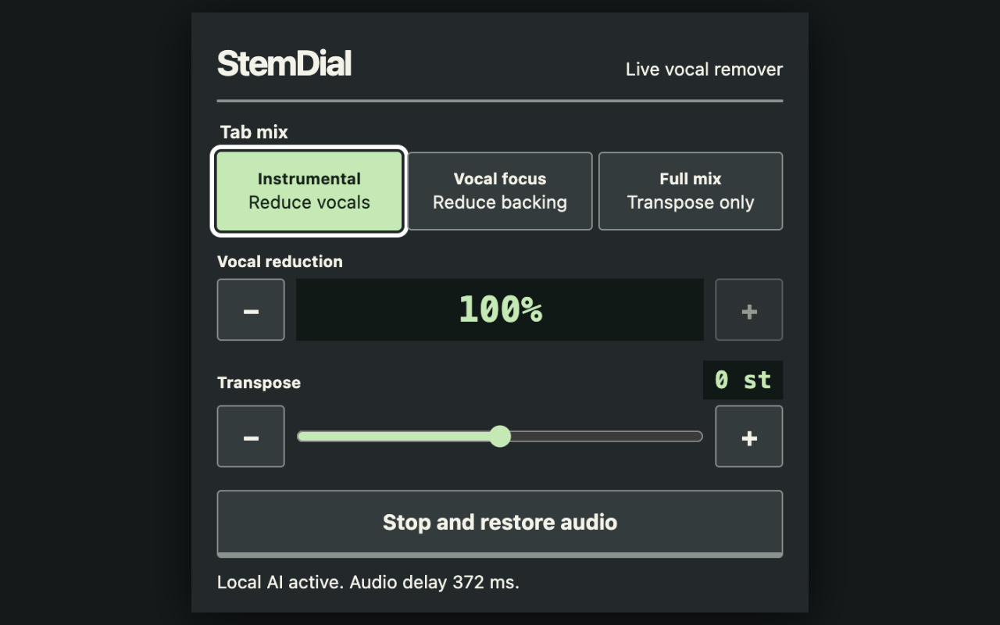

# StemDial

On-device AI vocal remover for Chromium-based browsers (Chrome, Edge, Brave, and others). Play a song in a tab, open StemDial, press **Start on this tab**, and the singer drops away while the video keeps playing. Switch to Vocal focus to keep the voice and lose the backing. Transpose shifts pitch up to 12 semitones in either direction without changing tempo.

No account, no subscription, no upload. The model is bundled and runs on your GPU.

StemDial is in beta. Expect artefacts: separation quality depends on the recording, and a busy mix gives the separator more to untangle than a sparse one. Report problems on the repository issue tracker.

## Modes

| Mode | What you hear |
| --- | --- |
| Instrumental | Vocal separated out. Bass and instruments stay. |
| Vocal focus | Voice kept, backing reduced. |
| Full mix | Nothing separated. Transpose only. The separator still adds its audio delay. |

Instrumental and Vocal focus keep their own reduction level. Use **− / +** for 5 percentage points at a time. At 0% no separation is mixed in; 100% uses the separated stem. Transpose works in every mode, in single semitones or on a slider.

## Requirements

A Chromium-based desktop browser, version 116 or newer, with hardware acceleration and a working WebGPU adapter. Development and testing happen on Chrome. Check `chrome://gpu` if the AI never starts; StemDial falls back to a stereo filter and says so in the popup.

The AI adds a delay between the video and the sound, because the separator needs a slice of future audio before it can decide what is a voice. The delay is measured on your machine and never exceeds 300 ms: about 225 ms on this MacBook Air, more on a slower GPU. A GPU too slow to stay under 300 ms uses the stereo filter instead. The popup shows the value in use.

When the GPU misses a slice, that slice plays as the original mix and the separator rejoins at the right place in the song. Nothing pauses or drifts out of sync.

If the GPU stays too slow, StemDial swaps to the stereo filter without stopping playback. The fallback cancels centre-panned sound and leaves the sides, so a voice hard-panned to one side survives it. Vocal focus estimates the centre per frequency bin with an FFT, so most panned and wide backing cancels instead of leaking through; backing that is genuinely centred still cannot be separated without the model. A warning banner appears whenever the AI is not the active engine. The gear menu chooses AI with stereo fallback, AI only (play the original mix and warn), or stereo only. Changing the engine restarts the audio immediately and persists for the next session.

## Install

From a release zip:

1. Download `stemdial-<version>.zip` from the repository's Releases page and extract it. You get a `stemdial` folder.
2. Open `chrome://extensions`, enable **Developer mode**, select **Load unpacked**, and choose that folder.

From a clone:

1. Clone or download this repository. No build step or API key.
2. In the same `chrome://extensions` page, select **Load unpacked** and choose the folder containing `manifest.json`.

Then play a song, open **StemDial**, pick a mode, and press **Start on this tab**. Changes apply while playing. Close the popup to keep listening, reopen it to adjust, and press **Stop and restore audio** to hear the original mix again.

Chrome installs extensions from a folder or from the Web Store. It rejects a self-signed `.crx` unless an enterprise policy allows it, so the zip above is the supported path.

## How it works

The captured tab audio is cut into 23 ms slices and separated in groups of four or more, depending on GPU speed. A vocal separation model runs on the GPU over a rolling 32-frame spectrogram, and the result is mixed back into the delayed original. Audio stays in the browser; the extension makes no network requests while playing.

The bundled model is Kuielab MDX-Net, converted to fp16. Model provenance, hashes, and the CC BY 4.0 licence are in [docs/ASSETS.md](docs/ASSETS.md).

## Privacy

Audio is processed on your device and never uploaded. Details: [PRIVACY.md](PRIVACY.md). Store submission notes: [docs/STORE.md](docs/STORE.md).

## Source

MIT. Development and release notes are in [docs/DEVELOPING.md](docs/DEVELOPING.md). Maintained by [@bintangf](https://github.com/bintangf).

The vocal separator is the KUIELab-MDX-Net model, used under CC BY 4.0. Details in [docs/ASSETS.md](docs/ASSETS.md).
